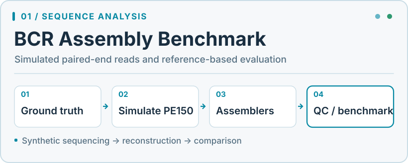
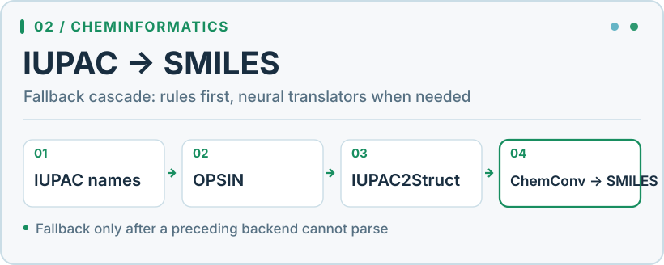
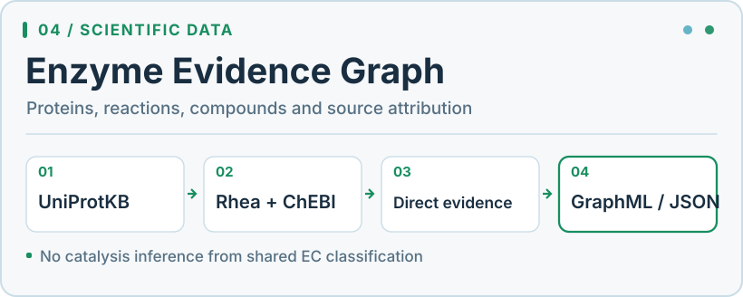
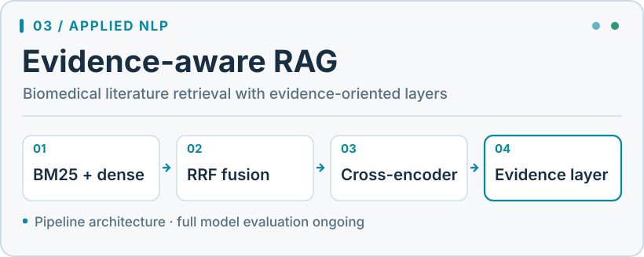
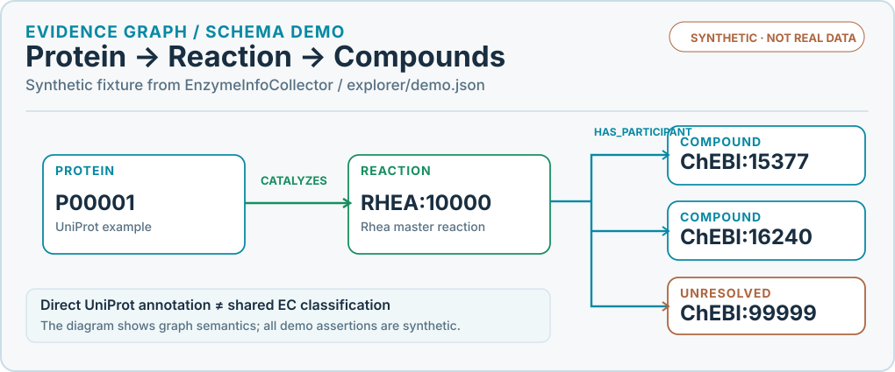

<picture>
  <source media="(prefers-color-scheme: dark)" srcset="assets/computational-lab-dark.svg" />
  
</picture>

<picture>
  <source media="(prefers-color-scheme: dark)" srcset="https://readme-typing-svg.demolab.com?font=Fira+Code&weight=500&size=17&duration=3100&pause=1100&color=22D3EE&center=true&vCenter=true&width=800&height=44&lines=Sequence+data+%E2%86%92+reproducible+pipelines;Chemical+names+%E2%86%92+molecular+representations;Research+papers+%E2%86%92+retrieval+%26+reasoning" />
  
</picture>

### Scientific systems

A selection of projects at the intersection of computational biology, chemical data and AI engineering.

<table>
<tr>
  <td width="50%" valign="top">
    <a href="https://github.com/VasilijEpishkin/bcr-assembler">
      <picture>
        <source media="(prefers-color-scheme: dark)" srcset="assets/projects/bcr-assembler.dark.svg" />
        
      </picture>
    </a>
  </td>
  <td width="50%" valign="top">
    <a href="https://github.com/VasilijEpishkin/iupac2smiles">
      <picture>
        <source media="(prefers-color-scheme: dark)" srcset="assets/projects/iupac2smiles.dark.svg" />
        
      </picture>
    </a>
  </td>
</tr>
<tr>
  <td width="50%" valign="top">
    <a href="https://github.com/VasilijEpishkin/EnzymeInfoCollector">
      <picture>
        <source media="(prefers-color-scheme: dark)" srcset="assets/projects/EnzymeInfoCollector.dark.svg" />
        
      </picture>
    </a>
  </td>
  <td width="50%" valign="top">
    <a href="https://github.com/VasilijEpishkin/alzheimer-rag-agent">
      <picture>
        <source media="(prefers-color-scheme: dark)" srcset="assets/projects/alzheimer-rag-agent.dark.svg" />
        
      </picture>
    </a>
  </td>
</tr>
</table>

Click a system diagram to open its source repository. Diagrams describe implemented workflows, not performance claims.

### Research & engineering

| Computational biology & chemistry | Data science & AI |
| :--- | :--- |
| Sequence reconstruction, enzyme and reaction evidence, molecular representations and reproducible data workflows. | Applied ML/NLP, retrieval and reranking, research tooling, Python automation and AI-assisted analysis. |

### Technical stack

**Scientific computing & machine learning**

**Tooling & reproducibility**

### Evidence & reproducibility

- **[IUPAC → SMILES: benchmarking](https://github.com/VasilijEpishkin/iupac2smiles#benchmark)** — documented reference-based evaluation procedure.
- **[BCR assembly: comparison report](https://github.com/VasilijEpishkin/bcr-assembler/blob/main/docs/evaluation_history/assembler_comparison_report.md)** — experiment setup, metrics and assembler comparison.
- **[Enzyme graph: evidence and provenance](https://github.com/VasilijEpishkin/EnzymeInfoCollector/blob/main/docs/architecture/graph_export.md)** — source assertions, identifiers, releases and graph export.
- **[Biomedical RAG: acceptance criteria](https://github.com/VasilijEpishkin/alzheimer-rag-agent/blob/main/docs/ACCEPTANCE.md)** — tests and remaining evaluation requirements, including incomplete validation.

<strong>Explore the enzyme evidence-graph schema</strong>

<picture>
  <source media="(prefers-color-scheme: dark)" srcset="assets/projects/evidence-network.dark.svg" />
  
</picture>

This visualization reproduces the **synthetic demo structure** bundled with
[EnzymeInfoCollector's local explorer](https://github.com/VasilijEpishkin/EnzymeInfoCollector/tree/main/explorer).
It is **not experimental biological evidence**. In real data, a `CATALYZES` edge requires a direct source annotation;
sharing an EC classification never establishes catalysis. Unresolved compounds remain explicit.

### GitHub activity · Development telemetry

<a href="https://gitcard-studio.creativecode.com.co/">
  <picture>
    <source media="(prefers-color-scheme: dark)" srcset="https://gitcard-studio.creativecode.com.co/api/stats?username=VasilijEpishkin&amp;theme=dark&amp;locale=en" />
    
  </picture>
</a>

**Contribution landscape** · An isometric view of the past year's activity.

<picture>
  <source media="(prefers-color-scheme: dark)" srcset="assets/activity/contributions.dark.svg" />
  
</picture>

<strong>Commit cadence · Weekday × hour heatmap</strong>

<picture>
  <source media="(prefers-color-scheme: dark)" srcset="assets/activity/cadence.dark.svg" />
  
</picture>

Graphs are generated from GitHub activity each day; the cadence chart covers commits visible to the generator, not all work performed offline.
