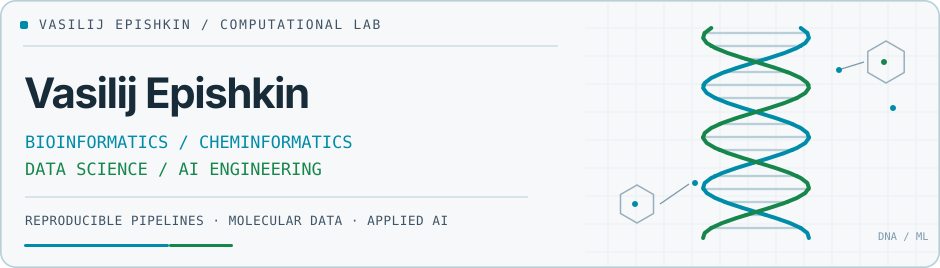

<picture>
  <source media="(prefers-color-scheme: dark)" srcset="assets/computational-lab-dark.svg" />
  
</picture>

<picture>
  <source media="(prefers-color-scheme: dark)" srcset="https://readme-typing-svg.demolab.com?font=Fira+Code&weight=500&size=17&duration=3100&pause=1100&color=22D3EE&center=true&vCenter=true&width=800&height=44&lines=Sequence+data+%E2%86%92+reproducible+pipelines;Chemical+names+%E2%86%92+molecular+representations;Research+papers+%E2%86%92+retrieval+%26+reasoning" />
  
</picture>

### Research & Engineering

| 01 / Biological & chemical data | 02 / Data science & AI |
| :--- | :--- |
| Sequencing data, BCR reconstruction, enzyme annotations, molecular representations and reproducible research workflows. | Applied ML/NLP, literature retrieval and reranking, Python tools and AI-assisted scientific analysis. |

### Selected work

| Project | What it solves |
| :--- | :--- |
| **[bcr-assembler](https://github.com/VasilijEpishkin/bcr-assembler)** | Simulates fragmented BCR sequencing reads and benchmarks sequence assemblers against known references. |
| **[iupac2smiles](https://github.com/VasilijEpishkin/iupac2smiles)** | Translates chemical names into SMILES with a fallback cascade of rule-based and neural models. |
| **[alzheimer-rag-agent](https://github.com/VasilijEpishkin/alzheimer-rag-agent)** | Retrieves and reranks biomedical literature for exploring potential Alzheimer's disease drug targets. |
| **[EnzymeInfoCollector](https://github.com/VasilijEpishkin/EnzymeInfoCollector)** | Collects enzyme records, protein sequences and reaction data from ExPASy, UniProt and Rhea. |

### Technical stack

**Scientific computing & machine learning**

**Tooling & reproducibility**

### GitHub activity · Development telemetry

<a href="https://gitcard-studio.creativecode.com.co/">
  <picture>
    <source media="(prefers-color-scheme: dark)" srcset="https://gitcard-studio.creativecode.com.co/api/stats?username=VasilijEpishkin&amp;theme=dark&amp;locale=en" />
    
  </picture>
</a>

**Contribution landscape** · An isometric view of the past year's activity.

<picture>
  <source media="(prefers-color-scheme: dark)" srcset="assets/activity/contributions.dark.svg" />
  
</picture>

<strong>Commit cadence · Weekday × hour heatmap</strong>

<picture>
  <source media="(prefers-color-scheme: dark)" srcset="assets/activity/cadence.dark.svg" />
  
</picture>

Graphs are generated from GitHub activity each day; the cadence chart covers commits visible to the generator, not all work performed offline.
